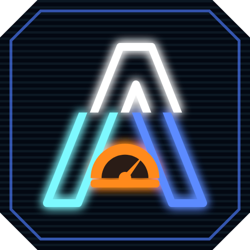

  

<h1 align="center">Aria Cockpit</h1>

  Le tableau de bord de ton PC de jeu : il analyse le matériel, surveille ta carte graphique en direct 
  et te propose les bons réglages Windows, NVIDIA et confidentialité, jusqu'à l'undervolt guidé. 
  Rien n'est modifié sans ton accord, tout se restaure. Rien à installer.

  <a href="../../releases/latest"><b>Télécharger la dernière version</b></a> · v0.18 · Windows 11 x64 · carte NVIDIA conseillée

## Ce qu'il fait

| Page | Ce que ça fait |
| --- | --- |
| **Mon PC** | Un cockpit : composants détectés de part et d'autre, jauge de conformité au centre. Diagnostic complet, guide BIOS selon la marque de la carte mère, fiche PC en HTML |
| **Télémétrie GPU** | Sur Mon PC, la carte NVIDIA en direct : température, charge, mémoire vidéo, fréquence, consommation, ventilateur. Une lecture par seconde, seulement quand la page est affichée |
| **Analyse de performance** | Tu joues, Aria Cockpit enregistre (le chrono ne démarre que quand ton jeu tourne vraiment), puis il dit ce qui limite : température, puissance, processeur, mémoire vidéo, limiteur d'images. Il repère aussi un plantage du pilote ou du jeu, et compare avec l'analyse précédente |
| **Réglages** | Windows, NVIDIA, confidentialité, programmes au démarrage, applications préinstallées : valeur actuelle → valeur proposée, liste à cocher, puis résultat |
| **Réglage GPU** | Limite de puissance, plafond et décalages de fréquence par l'interface officielle du pilote NVIDIA. Un assistant guidé (Équilibre, puis Économie ou Performance) cherche le meilleur réglage palier par palier, sur le banc d'essai Aria ou dans ton jeu ; un garde-fou signale les plantages du pilote |
| **Banc d'essai Aria** | Une scène 3D maison (Direct3D 12) en 1080p, 1440p ou 4K, de Faible à Ultra : FPS, 1 % les plus bas, saccades, et des images de contrôle vérifiées au pixel près pour repérer un réglage instable même sans plantage |
| **Mises à jour** | Windows Update, applications (winget), pilote NVIDIA et BIOS. Au lancement, Aria Cockpit te prévient aussi quand une nouvelle version est publiée |
| **Nettoyage** | Espace récupérable par élément, suppression après confirmation |
| **Restauration** | Choix d'une sauvegarde, puis retour aux valeurs enregistrées (lui-même annulable) |
| **Rapports** | Tous les rapports (réglages, restaurations, mises à jour, nettoyages, fiches PC) avec leur bilan et un aperçu |

**Rien n'est modifié sans ton accord.** Chaque changement est récapitulé avant d'être appliqué. Aria Cockpit sauvegarde
d'abord les valeurs d'origine et crée un point de restauration Windows : tout se restaure en quelques clics. Le BIOS
n'est jamais modifié, seulement lu et expliqué.

## Installation

1. Télécharge l'un des deux zips dans les [Releases](../../releases) et décompresse-le où tu veux :

   | Fichier | Pour qui |
   |---|---|
   | `Aria-Cockpit-<version>-autonome.zip` | Tout le monde : rien à installer (≈ 215 Mo une fois décompressé) |
   | `Aria-Cockpit-<version>-leger.zip` | PC qui ont déjà le [runtime .NET 10 Desktop](https://dotnet.microsoft.com/download/dotnet/10.0) (≈ 11 Mo) |

   Le zip contient `Aria-Cockpit.exe` et `Aria-Bench.exe`, le banc d'essai : garde-les dans le même dossier.

2. Lance `Aria-Cockpit.exe`. L'exe n'est pas signé : si Windows SmartScreen affiche « Windows a protégé votre
   ordinateur », clique sur « Informations complémentaires » puis « Exécuter quand même ». Le code source complet est
   dans ce dépôt.

Aria Cockpit demande les **droits administrateur** : il en a besoin pour lire et modifier les réglages du système.
Lance-le depuis ta propre session (si un autre compte administrateur valide l'élévation, les réglages personnels
comme la souris ou le Mode Jeu s'appliqueraient à ce compte-là).

### Diagnostic (lecture seule)

Branchement des écrans (carte graphique ou carte mère), câble et fréquence, HDR, lien PCIe et Resizable BAR de la
carte NVIDIA, mémoire (canal, vitesse, profil XMP/EXPO), P-cores et E-cores, microcode Intel 13e et 14e génération,
mode de démarrage, Secure Boot et TPM, âge du BIOS et du pilote graphique, santé et espace libre des disques,
réseau, programmes au démarrage, protection du système, redémarrage en attente, batterie, G-SYNC (disponible mais
désactivé), conseil DLSS au modèle près, limite de puissance de la carte comparée à sa valeur d'usine (une carte
bridée par NVIDIA App ou Afterburner est signalée), et overclock de NVIDIA App (réglage automatique, scan en
arrière-plan, courbe enregistrée).

La carte NVIDIA est reconnue grâce à une table de 96 modèles GeForce, de la GTX 750 (Maxwell) aux RTX 50 (Blackwell),
bureau et portable (`config/gpus/geforce.json`) : architecture, type de mémoire (GDDR5 à GDDR7) et niveau de DLSS
s'affichent dans le cockpit. Fréquences et puissances ne sont pas dans la table : elles varient d'un fabricant à
l'autre et sont lues en direct sur la carte.

Les corrections qui se font dans le BIOS sont expliquées pas à pas pour ASUS, MSI, Gigabyte et ASRock (plus un guide
générique), avec un bouton pour redémarrer directement dans le BIOS.

### Télémétrie et analyse de performance

Les mesures viennent de NVML (`nvml.dll`, installé avec le pilote NVIDIA,
[documentation officielle](https://docs.nvidia.com/deploy/nvml-api/)), en lecture seule. L'analyse dure 5 minutes de
jeu : Aria Cockpit attend de voir ton jeu en action (5 secondes d'affilée, carte chargée), puis relève chaque seconde
les mesures du GPU, la raison officielle de chaque baisse de fréquence et la charge du processeur, cœur par cœur. Le
rapport donne un verdict et un « Que faire ? » pour chaque constat. Le bouton « Relancer » affiche les chiffres de
l'analyse précédente pour comparer. Les artefacts visuels et les saccades ne sont pas détectables de cette façon :
pour eux, tes yeux restent le meilleur juge.

## Réglages

### Windows

Fréquence maximale de chaque écran, plan d'alimentation adapté (Performances élevées avec état minimal du processeur
à 20 % sur un PC fixe), Mode Jeu, planification GPU accélérée, optimisations des jeux en mode fenêtré, taux de
rafraîchissement variable, enregistrement en arrière-plan de la Xbox Game Bar, accélération de la souris et, en option
de confort, animations de Windows.

### NVIDIA

Aria Cockpit parle au pilote via NVAPI (`nvapi64.dll`, installé avec le pilote), avec les seuls identifiants publiés par
NVIDIA dans le [SDK NVAPI](https://github.com/NVIDIA/nvapi) (licence MIT). Les réglages modifiés sont ceux du profil
global (« Paramètres globaux » de l'application NVIDIA) ; les profils propres à chaque jeu restent prioritaires.

| Réglage | Proposé | Condition |
|---|---|---|
| Mode faible latence | Activé (une image en attente) | toujours |
| Synchronisation verticale | Activée par le pilote | G-SYNC actif sur l'écran principal |
| Nombre d'images par seconde maximal | Fréquence max − 3 (ex. 141 à 144 Hz) | G-SYNC actif sur l'écran principal |
| Fréquence préférée | La plus élevée disponible | toujours |
| Taille du cache des shaders | Illimité | toujours |
| Gestion de l'alimentation | Retour à « Normal » | seulement si « Performances maximales » |
| Processeur graphique préféré | Processeur NVIDIA (décoché, autonomie réduite) | portable à deux puces graphiques |
| Plage dynamique (par écran) | Complète (0-255) | écran NVIDIA en plage limitée, RGB, sans HDR |

Un réglage jamais modifié s'affiche « (par défaut) » ; le restaurer remet la valeur d'usine du pilote. Aria Cockpit ne peut
pas activer G-SYNC lui-même (absent de l'API officielle) : le diagnostic indique où le faire. Ferme le Panneau de
configuration NVIDIA avant d'appliquer : un clic sur « Appliquer » de sa part pourrait remettre ses anciennes valeurs.

### Confidentialité

Réglages officiels (Policy CSP Microsoft, valables sur Windows 11 Pro) ou options écrites par les Paramètres eux-mêmes.
Couper des services n'apporte aucun gain de performances mesurable : l'intérêt est la vie privée et la réduction de la
surface d'attaque.

- **Cochés** :
  - données de diagnostic au minimum (niveau « Obligatoire » ; le niveau zéro est réservé à Entreprise et Éducation) ;
  - demandes de commentaires, expériences personnalisées, identifiant de publicité, historique d'activité ;
  - recherche Bing du menu Démarrer (effet secondaire : plus de recherches récentes dans l'Explorateur) ;
  - recommandations du menu Démarrer, suggestions et astuces (Paramètres, écran de verrouillage) ;
  - suivi des applications lancées, liste de langues envoyée aux sites ;
  - services Télémétrie (DiagTrack) et Fax ;
  - spouleur d'impression **seulement si aucune imprimante réelle** (« Imprimer en PDF » ne fonctionnera plus) ;
  - Recall, **seulement sur un PC Copilot+ où il est activé** : stratégie officielle `DisableAIDataAnalysis`, qui arrête
    les captures d'écran ; les captures déjà enregistrées sont supprimées définitivement (Recall n'est pas désinstallé).
- **Décochés, au choix** :
  - application Copilot (désinstallée pour le compte ; la stratégie « Désactiver Copilot » ne concerne plus la nouvelle
    application ; la restauration ouvre le Microsoft Store) ;
  - services Xbox Live (seulement sans application Xbox ni Game Pass) ;
  - géolocalisation (PC fixe).
- **Jamais touchés** : Windows Search, SysMain, Windows Update, Defender, BITS, audio, Bluetooth, réseau, service des
  accessoires Xbox (manettes).
- **Widgets** : non gérés. Leur stratégie officielle (`HKLM\SOFTWARE\Policies\Microsoft\Dsh`) est verrouillée par Windows,
  même pour un administrateur. Pour masquer le bouton : Paramètres → Personnalisation → Barre des tâches → Widgets.

### Démarrage

Les programmes lancés à l'ouverture de session, comme dans l'onglet Démarrage du Gestionnaire des tâches et avec le
même mécanisme : nom et éditeur, compte concerné, tout décoché par défaut. Désactiver ne désinstalle rien et se
réactive depuis Restauration ou le Gestionnaire des tâches. Les composants de sécurité de Windows ne sont jamais
proposés.

### Applications

33 applications préinstallées par Windows : Clipchamp, Actualités, Météo, Solitaire, Astuces, To Do, Teams, Cartes,
LinkedIn, Mobile connecté, Microsoft 365 Copilot… ; **Assistance rapide** (prise de contrôle à distance, très utilisée par
les arnaques au faux support technique) ; les applications abandonnées que gardent les anciennes installations (Films et
TV, Courrier et Calendrier, Contacts, Skype) ; et les applis tierces installées en promotion sur les PC neufs (Spotify,
Disney+, Netflix, Prime Video, TikTok, Candy Crush, Facebook, Instagram, WhatsApp). Seules celles réellement installées apparaissent, toutes décochées.
La désinstallation ne concerne que ton compte ; la restauration ouvre la page de l'application dans le Microsoft Store.
Xbox, Game Bar, le Store et les outils du quotidien (Photos, Calculatrice, Bloc-notes, Terminal, Magnétophone…) restent
hors liste.

## Réglage GPU

Par NVML, l'interface officielle du pilote NVIDIA. Le pilote garde la main sur la tension : ces réglages ne peuvent
pas dépasser les limites de sécurité de la carte. Au pire, un jeu ou le pilote plante (écran noir quelques secondes).

| Réglage | Ce qu'il fait | Bornes d'Aria Cockpit |
|---|---|---|
| Limite de puissance | Plafond de consommation de la carte | plage de la carte |
| Plafond de fréquence | La carte ne dépasse plus cette fréquence et redescend normalement au repos | de 1 200 MHz au maximum de la carte |
| Décalage GPU | Décale la courbe fréquence/tension : plus de MHz à tension égale | ± 300 MHz |
| Décalage mémoire | Fréquence de la mémoire vidéo | − 500 à + 1 500 MHz |

**Selon la carte** : le plafond de fréquence n'existe qu'à partir de Turing (GTX 16, RTX 20) ; sur une GTX 900 ou 10,
Équilibre cale la limite de puissance sur la consommation mesurée et Économie baisse cette limite. Sur beaucoup de
portables, la limite de puissance est verrouillée par le fabricant : le curseur est alors désactivé, avec la raison.

**Undervolt** = décalage GPU positif + plafond à la fréquence haute habituelle en jeu : même fréquence, donc mêmes FPS,
atteinte avec moins de tension, donc moins de watts, de chaleur et de bruit.

- **Essayer** : le réglage s'efface au prochain redémarrage.
- **Garder au démarrage** : la tâche planifiée « Aria Cockpit\Profil GPU » le réapplique à chaque ouverture de session
  (Aria Cockpit en mode silencieux, droits administrateur, sans fenêtre).
- **Revenir d'origine** : remet la carte à ses **valeurs d'usine** (limite de puissance par défaut lue sur la carte, sans
  plafond ni décalage) et supprime la tâche. Une limite posée avant par un autre outil (NVIDIA App, Afterburner) ne
  compte pas comme origine ; elle reste dans la sauvegarde « Avant réglage GPU », que la page Restauration peut remettre.
- **Réglage d'Équilibre** : remet le résultat d'Équilibre dans les curseurs (Appliquer le pose ensuite). À la fin
  d'Économie ou de Performance, « Revenir à Équilibre » le pose directement, même après un redémarrage entre les deux.
- **Garde-fou** : si Windows note un plantage du pilote NVIDIA depuis le réglage, un bandeau rouge le signale.

### L'assistant guidé : Équilibre, puis Économie ou Performance

**Contrôle avant mesure.** Avant chaque mode, Aria lit (sans rien y écrire) la base de réglages de NVIDIA App. Si son
overclock est actif, il se superposerait aux paliers : l'assistant s'arrête, explique où le désactiver, propose d'ouvrir
NVIDIA App, puis de vérifier à nouveau (ou de continuer quand même, à tes risques). NVIDIA ne publie aucune interface
pour le couper : c'est toi qui le fais. Une limite de puissance posée par un autre outil est aussi signalée : Aria pose
ses propres valeurs pendant les mesures, mais l'outil la reposera au démarrage tant qu'il n'est pas remis par défaut.

Chaque mesure se fait **sur le banc d'essai Aria** (par défaut) ou **dans ton jeu**, au choix avant de commencer :

| | Banc d'essai Aria | Ton jeu |
|---|---|---|
| Déroulé | Le banc s'ouvre en plein écran (Ultra, à la définition de ton écran) pendant le palier, puis se ferme seul | La mesure démarre quand Aria voit ton jeu en action |
| Verdict (Équilibre, Performance, validation) | **Automatique** : erreur de calcul ou plantage du pilote → pas plus fin ; sinon le palier tient et le suivant s'enchaîne | Le tien : artefacts ou plantage ? |
| Mesures comparées | Fréquence, watts, température et **FPS** | Fréquence, watts, température |

Économie garde ta décision à chaque palier (la fluidité acceptable, c'est toi qui la juges), avec la perte de FPS mesurée par le banc.
Si le banc d'essai bute sur une limite d'images (V-Sync, limite du pilote), l'assistant refait la mesure à la définition
supérieure pour charger la carte à fond. Sur un portable, branche-le sur secteur : sur batterie, la carte est bridée.

| Mode | Ce qu'il cherche | Comment |
|---|---|---|
| **Équilibre** (en premier) | Les mêmes FPS avec moins de watts | Mesure de départ aux valeurs d'usine, plafond à la fréquence haute que la carte atteint régulièrement en jeu (90e centile), puis décalage GPU croissant : + 100, + 30, puis + 15 MHz |
| **Économie** | Encore moins de watts et de bruit | Part du réglage d'Équilibre et baisse le plafond : environ 5 %, puis 2,5 %, puis 15 MHz, 15 % au plus. À chaque palier, la perte mesurée s'affiche (« Fréquence -5 %, -48 W, -6 °C ») et tu décides |
| **Performance** | La fréquence la plus haute qui reste stable | Part de la courbe d'usine (décalage GPU nul), sans plafond, limite de puissance au maximum de la carte ; mesure ce réglage de base, puis décalage croissant : + 60, + 30, puis + 15 MHz. Le décalage d'Équilibre ne sert pas de départ : le plafond ne l'a éprouvé qu'en bas de la courbe |

- **Avis d'Aria à la fin de Performance** : le gain est comparé au réglage d'Équilibre (FPS, watts, température,
  FPS par watt). Moins de 3 % de FPS en plus, ou plus de 3 W par FPS gagné : « ne vaut pas le coup », et « Revenir à
  Équilibre » passe en tête ; au moins 8 % pour 3 W par FPS au plus : « vaut le coup » ; entre les deux : « gain réel mais
  cher ». Les mesures d'Équilibre viennent de sa validation de 15 minutes si elle a réussi.
- **Équilibre débloque les deux autres.** Son résultat (réglage retenu, mesure de départ, jeu, carte, pilote) est gardé
  dans `equilibre.json` : Économie part de lui, Performance en garde le décalage mémoire, et tous deux se comparent à la même mesure. Il est invalidé si tu
  changes de carte graphique ; après une mise à jour du pilote, refaire Équilibre est conseillé.
- **Recherche du grossier vers le fin** : grands pas tant que ça tient, puis pas moyens à partir du dernier palier
  stable, puis un dernier affinage (exemple : +100 ✓, +200 ✓, +300 ✗, +230 ✓, +260 ✗, +245 ✓).
- **Recul de sécurité** : quand un palier a planté juste au-dessus, le résultat recule d'un cran (15 MHz). Dans
  l'exemple, +230 est gardé plutôt que +245.
- **Ton verdict à chaque palier** : artefacts ou plantage (pour Équilibre et Performance), perte jugée acceptable ou non
  (pour Économie). Un plantage du pilote ou du jeu détecté par Windows fait passer à un palier plus prudent.
- **Mémoire** en option à la fin d'Équilibre et de Performance : paliers de + 250 MHz jusqu'à + 1 000.
- **Validation de 15 minutes** (conseillée) sur le réglage retenu, avant de le garder : un réglage peut tenir 3 minutes
  et lâcher au bout d'un quart d'heure. En cas de problème, il recule encore d'un cran.
- **À la fin, c'est toi qui choisis** : garder au démarrage, garder jusqu'au redémarrage, ou tout annuler.

Limites connues : le décalage s'applique à toute la courbe, y compris aux basses tensions du bureau, alors que les
mesures se font en jeu ; le garde-fou signale un éventuel plantage au repos après coup. Les artefacts visuels ne sont
pas détectables automatiquement : tes yeux restent le juge.

## Banc d'essai Aria

`Aria-Bench.exe`, livré à côté d'Aria Cockpit, dessine une scène 3D générée par le programme (rien à télécharger) :
terrain et montagnes, ville de tours aux fenêtres éclairées, soleil de fin de journée avec ombres portées, lumières
néon, occlusion ambiante, halo lumineux. Il tourne dans son propre processus : si un réglage fait planter le pilote,
Aria Cockpit reste debout et le constate. Rendu interne en 1080p, 1440p ou 4K (16:9, bandes noires si l'écran est en
16:10), affichage sans V-Sync.

| Préréglage | Terrain | Objets | Ombres | Lumières néon | Occlusion ambiante | Halo |
|---|---|---|---|---|---|---|
| Faible | 256² | 4 096 | 1024 px, nettes | 8 | non | non |
| Moyen | 512² | 12 100 | 2048 px, adoucies | 32 | 8 échantillons | 3 niveaux |
| Élevé | 768² | 28 900 | 4096 px, adoucies | 64 | 12 échantillons | 4 niveaux |
| Ultra | 1024² | 57 600 | 4096 px, très adoucies | 96 | 16 échantillons | 5 niveaux |

- **Vérification des images** : une image de contrôle (toujours le même instant de la scène) est calculée après la
  chauffe, puis recalculée toutes les 3 secondes et comparée au pixel près. Sur une carte stable, le résultat est
  identique. En cas d'écart, l'image est recalculée aussitôt : si elle redonne exactement le même résultat, c'est le
  pilote qui a réoptimisé ses shaders (écarts d'un ou deux niveaux, stables) et la référence est mise à jour ; sinon,
  c'est une erreur de calcul, typique d'un undervolt ou d'un overclocking trop poussé. `--images` enregistre alors la
  référence, l'image fautive et la carte des écarts en BMP.
- **Mesures** : FPS moyens et médians, 1 % les plus bas, temps par image, saccades (images plus de 2,5 fois plus longues
  que la normale). Les premières secondes de chaque passe ne comptent pas (montée en fréquence).
- **Contexte** : alimentation (secteur ou batterie), fréquence de l'écran ; une mesure collée à une limite (V-Sync,
  limite d'images du pilote, 60 ou 30 FPS) est signalée « plafonnée » : la carte n'y est pas mesurée à fond.
- **Journal** : `bench-<date>.json` (et `bench-dernier.json`) à côté de l'exe : carte, pilote, contexte, résultats,
  erreurs. C'est lui qu'Aria Cockpit lit.

Lancement à la main (Échap arrête) :

    Aria-Bench.exe                                  Élevé, 1080p puis 1440p puis 4K, 20 s chacune
    Aria-Bench.exe --qualite tout --def 1440        Les quatre préréglages en 1440p
    Aria-Bench.exe --qualite ultra --def 4k --duree 60 --fenetre --debug --images --sortie resultat.json

`--debug` active la couche de diagnostic de Direct3D (fonctionnalité facultative « Outils graphiques » de Windows) :
les performances mesurées ne sont alors pas représentatives.

## Mises à jour

- **Windows Update** : interface officielle de Windows. Cochées d'office : sécurité, correctifs, antivirus.
  Jamais cochés d'office : pilotes proposés par Windows Update, nouvelles versions de Windows, préversions.
- **Applications** : winget (gestionnaire officiel de Windows). Une ligne mal lue n'est jamais proposée.
- **Pilote NVIDIA** : comparaison avec le dernier pilote Game Ready, via le service de recherche du site
  NVIDIA (non officiel). Téléchargement par le navigateur, l'installation reste celle de NVIDIA.
- **BIOS** : version installée et lien de recherche vers la page support ; jamais mis à jour par Aria Cockpit.
- **Aria Cockpit lui-même** : au lancement, un bandeau signale une nouvelle version publiée sur ce dépôt, avec un lien
  vers sa page. Rien n'est téléchargé ni installé automatiquement.

Un point de restauration Windows est créé avant chaque installation (Aria Cockpit ne désinstalle pas les mises à jour).
Les applications à mettre à jour qui sont ouvertes sont listées avec un compte à rebours de 20 s, puis fermées
normalement (fermeture forcée au bout de 10 s) ; on peut aussi les fermer tout de suite, les exclure ou annuler.
Le téléchargement des applications s'affiche en direct (« Téléchargement · 45 % · 44 Mo / 98 Mo »).

## Nettoyage

| Élément | Coché | Méthode |
|---|---|---|
| Fichiers temporaires (utilisateur et Windows) | oui | fichiers de plus de 7 jours ; fichiers en cours d'utilisation ignorés |
| Cache d'Optimisation de la distribution | oui | `Delete-DeliveryOptimizationCache` (commande officielle) |
| Anciens composants des mises à jour | oui | `DISM /Online /Cleanup-Image /StartComponentCleanup`, sans `/ResetBase` |
| Caches de shaders (NVIDIA, DirectX, AMD, Intel) | non | à vider en cas de saccades après une mise à jour du pilote |
| Rapports de plantage (minidumps) | non | utiles pour diagnostiquer un écran bleu |
| Ancienne installation de Windows (`Windows.old`) | non | Nettoyage de disque (`cleanmgr /sagerun`) ; plus de retour à la version précédente |

Garde-fous : seuls ces emplacements sont touchés ; aucun lien (jonction, lien symbolique) n'est suivi ; une racine
dangereuse (racine du disque, dossier Windows, profil, Program Files…) est refusée ; le dossier `TEMP` n'est accepté que
s'il s'appelle bien « Temp ». La corbeille et les documents ne sont jamais touchés. Une suppression est définitive.

## Fiche PC (HTML)

Boutons « Exporter en HTML » (Mon PC) et « Exporter la fiche PC » (Rapports) : un seul fichier autonome (matériel,
diagnostic, réglages, dernières actions), thème néon à l'écran et version claire à l'impression ou en PDF. La case
« Masquer les infos personnelles », cochée par défaut, remplace le nom du PC et de l'utilisateur, y compris dans les
chemins.

## Sauvegardes et rapports

- Sauvegardes des valeurs d'origine : `C:\ProgramData\AriaCockpit\Sauvegardes`
- Rapports : `C:\ProgramData\AriaCockpit\Rapports`
- Réglage GPU en place et journal de la tâche de démarrage : `gpu-profile.json` et `gpu-profile.log`
- Journal des erreurs : `C:\ProgramData\AriaCockpit\erreurs.log`

Les versions précédentes rangeaient leurs données dans `C:\ProgramData\Aria` (0.13 et 0.14) ou
`C:\ProgramData\PCTune` (0.12 et avant) : ce dossier est renommé automatiquement au premier lancement, les
sauvegardes restent donc restaurables.

Une restauration suit le même parcours qu'une application (nouvelle sauvegarde, point de restauration, vérification,
rapport) : elle peut donc elle-même être annulée.

## Version console

    Aria.Cli                        Diagnostic, état actuel, liste à cocher, application des choix validés
    Aria.Cli --simulation           Affiche tout ce qui serait proposé, sans rien modifier
    Aria.Cli --restaurer [fichier]  Revient aux valeurs d'une sauvegarde (même liste à cocher)
    Aria.Cli --aide                 Aide

## Compiler soi-même

Prérequis :

- Windows 11
- [SDK .NET 10](https://dotnet.microsoft.com/download)
- Pour un éditeur : Visual Studio 2026 (version 18) ou plus récent, ou VS Code avec l'extension C# Dev Kit.
  Visual Studio 2022 ne sait pas cibler .NET 10.

Le plus simple : double-cliquer sur **`Lancer Aria Cockpit.cmd`**. Le script demande les droits administrateur, installe
le SDK .NET 10 via winget s'il manque, compile `publish\Aria-Cockpit.exe` et le banc d'essai `publish\Aria-Bench.exe`, puis
ouvre l'interface.

À la main, dans un terminal **administrateur** :

    dotnet run --project src/Aria.Gui                # lancer
    dotnet publish src/Aria.Gui -c Release           # exécutable unique autonome
    dotnet publish src/Aria.Gui -c Release -p:SelfContained=false   # version légère (runtime .NET 10 requis)
    dotnet publish src/Aria.Bench -c Release -r win-x64 -p:SelfContained=true -o <dossier d'Aria-Cockpit.exe>   # banc d'essai
    dotnet test tests/Aria.Tests -c Release          # tests (sans droits administrateur ni carte NVIDIA)

Résultat : `src/Aria.Gui/bin/Release/net10.0-windows/win-x64/publish/Aria-Cockpit.exe`

Version console en simulation, depuis la racine du projet :

    powershell -ExecutionPolicy Bypass -File outils\Lancer-Aria-Cockpit.ps1 -Console -Simulation

## Structure du projet

- `src/Aria.Core` : moteur (détection, diagnostic, réglages, NVIDIA, télémétrie et réglage GPU, confidentialité,
  mises à jour, nettoyage, sauvegarde, rapports), sans interface
- `src/Aria.Gui` : interface Windows 11 (WPF + WPF-UI) → `Aria-Cockpit.exe`
- `src/Aria.Cli` : version console → `Aria.Cli.exe`
- `src/Aria.Bench` : banc d'essai 3D (Direct3D 12) → `Aria-Bench.exe` ; shaders dans `Shaders/*.hlsl`, précompilés dans
  `Shaders/Compiled` par `outils/compiler-shaders.py` (aucun compilateur n'est livré avec l'exe)
- `tests/Aria.Tests` : tests xUnit de la logique d'Aria.Core (analyse de performance, recherche des paliers, origine
  d'usine, profil GPU, lecture de NVIDIA App sur bases factices, journal du banc, avis de Performance) ; rien n'y touche
  à la carte ni au système
- `config/bios/*.json` : base de connaissances BIOS par marque (où trouver chaque option)
- `config/gpus/geforce.json` : table des cartes GeForce (architecture, mémoire, bureau ou portable, RTX)
- `src/Aria.Gui/Assets/logo.svg` : source du logo (à rendre avec Chromium) ; `Aria-Cockpit.ico` en est le rendu de 16 à 256 px

Les fichiers BIOS sont intégrés à l'exécutable. Pour corriger un chemin sans recompiler : créer un dossier `bios` à
côté d'`Aria-Cockpit.exe` et y placer le fichier modifié (même nom) ; il remplace alors la version intégrée.

## Crédits

- Développé par Jérémy Zemani. Anciennement Aria (versions 0.13 et 0.14) et PC-Tune (jusqu'à la 0.12).
- Interface : [WPF-UI](https://github.com/lepoco/wpfui) (MIT) et CommunityToolkit.Mvvm (MIT).
- Banc d'essai : Direct3D 12 et DXGI pour .NET par [Vortice.Windows](https://github.com/amerkoleci/Vortice.Windows) (MIT) ;
  shaders compilés avec le [DirectX Shader Compiler](https://github.com/microsoft/DirectXShaderCompiler) de Microsoft.
- Identifiants des fonctions et réglages NVIDIA : [SDK NVAPI](https://github.com/NVIDIA/nvapi) (MIT).
- Télémétrie et réglage GPU : [NVML](https://docs.nvidia.com/deploy/nvml-api/) ; structures relues dans la bibliothèque
  officielle [nvidia-ml-py](https://pypi.org/project/nvidia-ml-py/).
- Table des modèles de cartes NVIDIA : [ZenitH-AT/nvidia-data](https://github.com/ZenitH-AT/nvidia-data)
  (domaine public). Copie intégrée dans `src/Aria.Core/Updates/nvidia-gpu-data.json`, mise à jour en ligne si possible.
- Recommandations G-SYNC : [Blur Busters, G-SYNC 101](https://www.blurbusters.com/gsync/gsync101-input-lag-tests-and-settings/14/).
- Réglages de confidentialité : documentation Microsoft (Policy CSP et « Manage connections from Windows operating
  system components to Microsoft services »).
